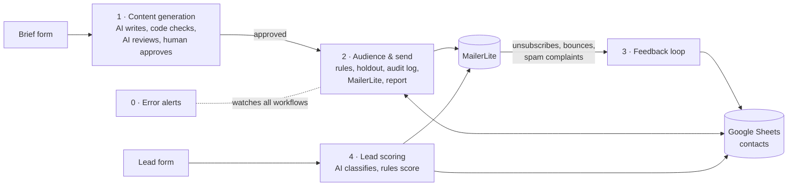

AI-assisted email marketing ops in n8n
A small, Marketo-style marketing automation system built in n8n with free tools only: Google Sheets as the database, MailerLite for sending, and Gemini for AI.
It writes on-brand campaign copy in 5 languages, has a human approve it, decides who should receive it (and logs why everyone else doesn't), sends it, syncs unsubscribes back, and scores new leads.  
Built by: Federico Ballini
---
How it fits together

Principle throughout: AI makes judgment calls, rules make decisions, and a human approves anything that goes out.
---
The workflows
#	Workflow	What it does
0	Error alerts	Emails me the workflow, the failed node and a link to the execution whenever an automatic run fails.
1	Content generation	Brief → copy for 3 segments × 5 languages → code checks → AI editor → one capped rewrite → approval email → starts workflow 2.
2	Audience & send	Picks the approved campaign, applies the audience rules with a reason for every contact, sends through MailerLite, writes results back and emails a report.
3	Feedback loop	MailerLite webhooks for unsubscribes, bounces and spam complaints update the contact sheet, so the next send excludes those people automatically.
4	Lead scoring	New lead → website fetched and cleaned → AI classifies industry, size, seniority, segment and intent → a fixed points table scores and grades the lead → saved to contacts → nurture or sales-ready group in MailerLite, plus a sales alert for grade A.
Each workflow has sticky notes on the canvas explaining every section.
1 · Content generation
Writing: a Basic LLM Chain with structured output writes subject, headline, body and CTA label natively per language, following a brand-voice guide and per-language forms of address (tu / du / vous). It doesn't translate from English.
Code checks before AI review: length, URLs and banned words are checked by code. That's cheaper and more reliable than asking a model.
AI editor: a second model checks tone, grammar, segment fit and claims not in the brief. An email passes only if both the code and the editor approve it.
One rewrite, capped: failures are rewritten once and flagged for the human. No loops, so cost stays predictable.
Human approval: Gmail "send and wait" with approve and disapprove buttons. Approving triggers workflow 2.
The CTA URL comes from the brief, never from the AI.
2 · Audience & send
Rules run in priority order, and every contact gets exactly one decision and one reason:
invalid email · 2. duplicate (compared in lowercase) · 3. unsubscribed · 4. bounced · 5. no opt-in · 6. existing customer on an acquisition campaign · 7. lifecycle stage not targeted · 8. emailed in the last 7 days
Language fallback: if no approved copy exists in a contact's language, they get English.
Holdout: a deterministic 10% control group, hashed on contact + campaign, so re-runs never move people between groups.
Audit trail: every decision is written to `audience_log`.
Sending: each contact's personalised copy is written into MailerLite custom fields. The contact is removed from and re-added to a trigger group, which starts a MailerLite automation whose email template uses merge tags.
Double-send guard: the campaign is marked `sent`, and only `approved` campaigns can be picked.
4 · Lead scoring
Signal (AI-classified, fixed allowed values)	Points
Industry	saas 20 · agency 15 · ecommerce / finance 10 · other 5
Company size	51–1000 employees 15 · 11–50 / 1000+ 10 · 1–10 5
Seniority	manager 15 · executive 12 · individual 8
Intent	high 10 · medium 5
Grade A is 45 or more (→ MQL, sales alert, sales ready group). Grade B is 25 or more (→ nurture group). Grade C is saved only.
Lifecycle only moves forward (lead → mql → customer). A customer filling in the form is never downgraded, and is flagged to sales as an expansion opportunity.
The form can grant marketing consent but never revoke it. Unsubscribes handle revocation.
Personal email domains (gmail etc.) are not enriched, so a gmail lead isn't scored as "Google".
---
How it maps to Marketo
Marketo	This build
Smart lists	Priority-ordered audience rules
Communication limits & suppression	7-day frequency cap + exclusions
Tokens / dynamic content	AI-written copy in MailerLite custom fields
Program approval	Gmail approve / disapprove
Control groups	Deterministic 10% holdout
Activity log	`audience_log` tab
Unsubscribe sync	MailerLite webhook → contact sheet
Lead scoring	AI classification + points table
Alerts	Error workflow, send report, hot-lead alert
---
Design decisions
Code for what code does well, AI for judgment. Length limits and banned words are checked by code; tone and nuance by AI.
Native nodes first. Edit Fields, If, Filter, the HTML extractor, the Information Extractor and Sheets "Append or Update" are used wherever they fit. The lead-scoring workflow uses one Code node, for the points table, because it's easier to read and edit as a single table.
Structured outputs with fixed allowed values, so downstream rules never meet unexpected categories.
Data, not memory, prevents mistakes: the `sent` status, the frequency cap and unsubscribe sync all live in the data.
Resilience: batching and retries for AI rate limits, "continue on error" where a failure shouldn't lose the record, and a central error workflow.
One contact table. Scored leads become campaign contacts with no extra sync.
---
Stack
n8n (Cloud) for orchestration
Google Sheets as the database: `contacts`, `copy_variants`, `campaigns`, `audience_log`
MailerLite (free plan) for sending, automations and webhooks
Gemini as the AI model, through n8n's LangChain nodes
Gmail for approvals, reports and alerts
---
Setup
Google Sheet: create the tabs below with these headers in row 1. Templates are in `/sheet-template`.
`contacts`: `email, first_name, language, country, segment, lifecycle_stage, opted_in, unsubscribed, bounced, last_emailed_at, is_customer, status_log`. Workflow 4 adds its scoring columns automatically.
`copy_variants`: `campaign_id, segment, language, subject, headline, body, cta_label, cta_url, review_score, issues, rewritten`
`campaigns`: `campaign_id, campaign_name, target_stages, cta_url, status, decided_at, sent_at`
`audience_log`: `campaign_id, email, first_name, segment, language, send_language, decision, reason, logged_at`
MailerLite:
Create the custom fields `ai_subject`, `ai_headline`, `ai_body`, `ai_cta_label`, `ai_cta_url`.
Create the groups `n8n – send queue`, `Leads – sales ready` and `Leads – nurture`.
Create an automation triggered when a subscriber joins `n8n – send queue`, with "allow re-entry" on, sending one email that uses the `{$ai_…}` merge tags.
Import the five JSON files from `/workflows` into n8n.
Connect your own credentials: Google Sheets, Gmail, MailerLite and Gemini (or any chat model).
Replace the placeholders: your MailerLite group IDs (workflow 2: Remove from queue and Add to queue; workflow 4: Add to MailerLite), your email address in the Gmail nodes, and your spreadsheet in each Sheets node.
Error workflow: in workflows 1–4, go to Settings → Error workflow → `0 – Error alerts`.
Activate workflows 3 and 4, then submit a brief through workflow 1's form.
`/sheet-template/test_contacts.csv` has 30 test contacts with deliberate edge cases: duplicates, unsubscribed, bounced, no opt-in, customers and recent sends. Expected result for a lead/MQL campaign: 18 eligible (about 2 held out), 12 excluded with reasons.
---
Known limitations
Google Sheets is not a database. It's fine for a demo, but slow and fragile at scale.
Deliverability: the demo sends from a free Gmail address. In production you'd send from an authenticated domain with SPF, DKIM and DMARC.
MailerLite's free plan doesn't allow HTML email content through the API, hence the custom-field and merge-tag approach.
MailerLite automations re-trigger at most once every 24 hours per subscriber.
Free-tier AI models are rate-limited and sometimes overloaded. A paid tier is recommended.
Rewritten copy isn't reviewed a second time. It's flagged for the human approver instead.
Holdout lift can't be measured yet, because there's no conversion data.
Engagement (opens and clicks) isn't part of the lead score yet.
What I'd do next
Move the data to Postgres or Supabase.
Use n8n Evaluations to measure how reliably the AI editor catches bad copy.
Add daily engagement re-scoring: a Schedule trigger plus MailerLite stats, added to the stored fit score.
Add a holdout lift report once conversion data exists.
Expose the campaign workflow as an MCP tool, so a campaign can be started from a chat.
---
Repository
```
README.md
workflows/        0–4 workflow exports (.json)
sheet-template/   header CSVs + 30 test contacts
screenshots/      canvases, approval email, report email
```
